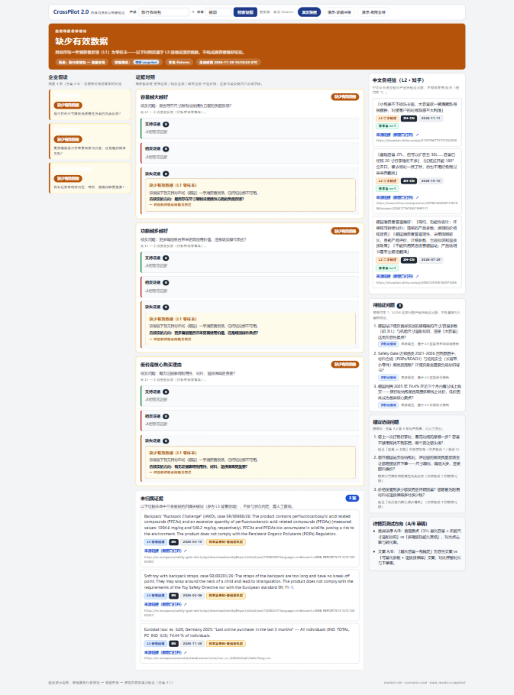

# CrossPilot 2.0

跨境消费者认知差验证 Agent —— 知乎黑客松 S3 / AI × 出海。

首个固定场景：**中国消费品品牌 → 德国市场 → 非电器旅行收纳包 → 商品详情页首屏卖点验证**。

产品形态是单页 Web 应用（三栏：企业假设 / 证据对照 / 验证动作），不是报告生成器。核心语义：L1 一手反馈支撑判定，L2 中文经验与 L3 监管/贸易语境只产出待验证问题；**证据不足与证据冲突都是必须显式可见的状态**，系统不编造结论。

- 演示 Runbook 与验收清单：[docs/demo/演示说明.md](docs/demo/演示说明.md)（fixtures 模式离线可演，三场景直达）
- 判定→建议→运营决定的闭环留痕：[docs/demo/validation_log.md](docs/demo/validation_log.md)
- 数据区索引与许可：[data/sources/README.md](data/sources/README.md)（9 来源 4.2 万行，四件套 + 原始响应留痕）

---

## 1. 五分钟上手

| 步骤 | 命令 | 说明 |
|---|---|---|
| 1 | `bash scripts/bootstrap.sh` | 建虚拟环境、装后端依赖、挂载源码路径、复制 `.env` |
| 2 | 编辑 `.env` 填密钥 | 知乎 Access Secret、Comtrade key 等；`.env` 已被 git 忽略 |
| 3 | `bash scripts/dev.sh api` | 启动 FastAPI，默认 <http://127.0.0.1:8000/docs> |
| 4 | `bash scripts/dev.sh web` | 启动 Nuxt，默认 <http://127.0.0.1:3000> |
| 5 | `bash scripts/check.sh` | 提交前五道自检：ruff + mypy strict + 全量测试 + 数据区结构校验 + 时间覆盖校验 |
| 6 | `bash scripts/check_web.sh` | 前端冒烟：37 断言（~15s），录屏/提交前必跑 |

Windows 下用 Git Bash 执行上述 `.sh`。

> **克隆须知**：两类数据不随仓库分发——① MARC 主表（Amazon 学术研究许可**禁再发布**，凭 `data/sources/_scripts/fetch_marc.py` 复现）；② 各来源 `raw/` 原始响应（体积策略，凭 `provenance.csv` 的 SHA-256 与 URL 复现）。因此 fresh clone 直接跑 `check.sh` 时 MARC 的结构校验一道会红，属预期；CI 只跑后端三道（ruff / mypy / 测试），克隆即绿。

> **为什么不用 `pip install -e`**：可编辑安装会调起构建后端子进程，在部分受管运行时下被环境守卫拦截。`bootstrap.sh` 改用「装依赖 + `.pth` 挂载 `apps/api/src`」，效果等价。改动依赖时同步 `apps/api/pyproject.toml`、`bootstrap.sh` 与 CI 三处。

## 2. 目录地图

| 路径 | 职责 | 谁动它 |
|---|---|---|
| `apps/api/` | FastAPI 后端：检索、立场抽取、证据分层、对照矩阵 | 后端 |
| `apps/api/src/crosspilot_api/domain/` | 纯领域模型与规则，**不依赖框架和网络** | 后端 |
| `apps/api/src/crosspilot_api/services/` | 外部数据源适配器（知乎、Amazon、Eurostat…） | 后端 |
| `apps/web/` | Nuxt 4 + Vue 3 三栏单页应用 | 前端 |
| `packages/contracts/` | 前后端共享契约（证据卡 / 对照矩阵 JSON Schema） | 前后端共同 |
| `data/sources/` | 外部数据唯一落地处（9 来源，每源四件套 + raw），见其 README | 数据负责人 |
| `data/snapshots/` | 演示预跑快照，**Demo 只读这里**，不走实时网络 | 全员 |
| `data/licenses/` | 各数据源许可原件，交付时随作品说明提交 | 数据负责人 |
| `docs/adr/` | 架构决策记录，一个决策一个文件，只增不改 | 决策人 |
| `docs/demo/` | 演示 Runbook、录屏脚本、验证日志与三场景截图 | 全员 |
| `docs/devlog/` | 开发日志，赛事创作真实性佐证，**每日必填** | 全员 |
| `docs/handover/` | 交接包：当前状态、待办、阻塞、联系人 | 当值负责人 |
| `scripts/` | 一键脚本，不手敲长命令 | 全员 |

## 3. 不可协商的五条硬约束

写进代码与评审清单，详见 `docs/CONSTRAINTS.md`。

| # | 约束 | 代码落点 |
|---|---|---|
| 1 | L2/L3 证据不得单独支撑「消费者偏好」结论，只能产出待验证问题 | `domain/evidence.py` 的 `can_support_preference_claim` |
| 2 | MARC 数据集在商业化路径启动即下线 | `services/datasets.py` 的 `COMMERCIAL_SAFE` 白名单 |
| 3 | OPUS 只取 ParaCrawl，排除 OpenSubtitles | 同上 |
| 4 | Comtrade 必须注册账号，禁用 preview 的 500 行截断结果 | 适配器拒绝无 key 调用 |
| 5 | DeepL API Free 档禁止传入含个人数据的文本 | `services/datasets.py` |

另有两条产品级强制项：**证据不足必须渲染为独立空状态卡片**，**证据冲突必须左右并排原文**。缺一即视为功能未完成。

## 4. 演示安全线

知乎 API 实测额度仅 10 次/日（搜索）、2 次/日（热榜、直答），远低于手册值。因此：

- Demo 默认 `CROSSPILOT_DATA_MODE=snapshot`，只读 `data/snapshots/`；
- 实时模式需显式设 `CROSSPILOT_DATA_MODE=live`；
- 额度耗尽必须出现明确降级提示，不得静默返回空结果。

## 5. 协作约定

- 分支：`feat/*`、`fix/*`、`docs/*`，从 `main` 切出，小步合并。
- 提交信息：`type(scope): summary`，例 `feat(evidence): add L1/L2/L3 level gate`。
- 合并前跑 `scripts/check.sh`，红灯不合。
- 每次 AI 辅助开发后，在 `docs/devlog/` 当日文件追加记录（赛事要求可核验创作真实性）。

## 6. 许可与数据

- **代码**：MIT（见 [LICENSE](LICENSE)）。
- **数据**：各来源许可不同、逐源声明——CC0 / 开放数据 / Apache-2.0 / CC-BY-4.0 / ODC-By 等均可随仓库分发（署名见各源 README）；唯 **MARC（Amazon 学术研究许可）禁再发布，不随仓库分发**，本地复现走 `fetch_marc.py`。汇总见 [data/sources/README.md](data/sources/README.md) 与 `docs/CONSTRAINTS.md`。
- **知乎快照**：真实采集片段已作者匿名化、摘录 ≤300 字符并链接回源，只作摘录引用、不建全文库。
