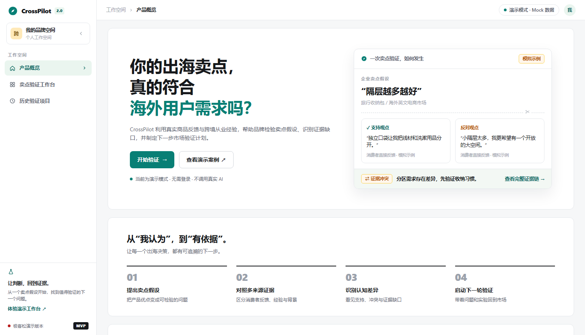
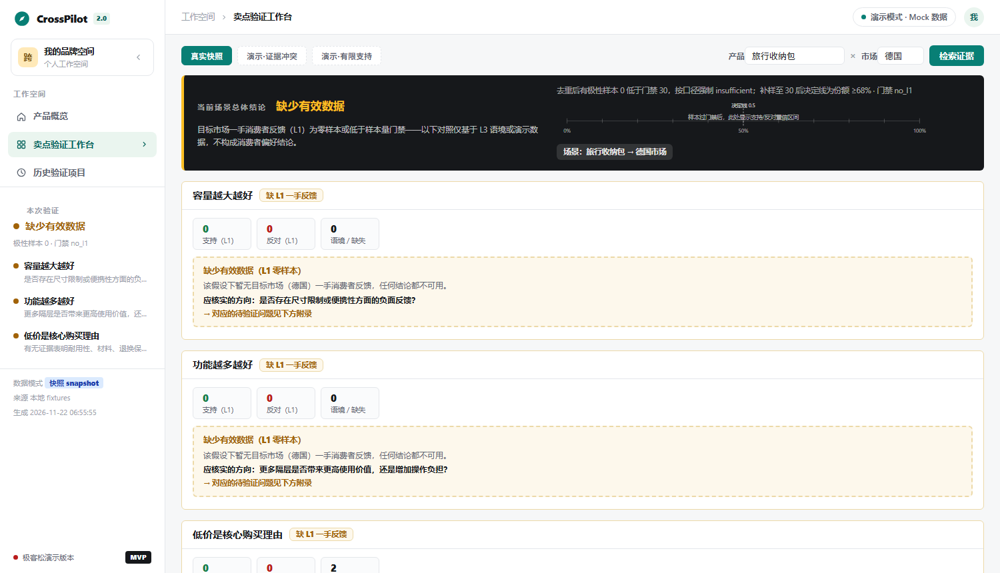
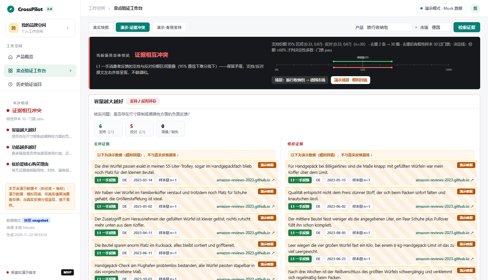
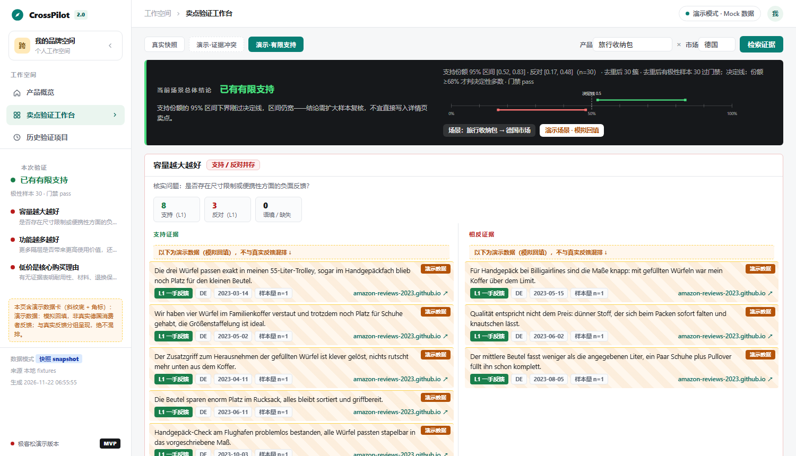

# CrossPilot 2.0 演示说明（Runbook）

> 面向录屏、路演与评委体验的操作说明 + 验收清单 + 合规自查。
> 定位：**出海卖点的上线前尽职调查**——把「要不要把某个卖点放上首屏」从猜，变成可回源的证据判定（叙事与答辩口径见第八节）。
> 固定演示边界：**非电器旅行收纳包 → 德国市场 → 详情页首屏卖点验证**（方案 4.1）。
> 最后核对：2026-11-21（fixtures 与 API 双模式实测；同日增补第八节叙事口径，纯文档层，无代码依赖）。

---

## 一、环境前置与启动顺序

### 1.1 前置条件

| 项 | 要求 | 核查方式 |
|---|---|---|
| Node | v24 / npm 11 | `node -v && npm -v` |
| 后端虚拟环境 | `.venv` 就绪（含 uvicorn / fastapi） | `ls .venv/Scripts/python.exe` |
| 数据区 | `data/sources/` 9 来源在位（检索服务零网络请求） | `bash scripts/check.sh` 五道全绿 |
| 知乎快照 | `data/snapshots/zhihu/旅行收纳包.json` 存在（API 模式 real 场景附录需要） | `ls data/snapshots/zhihu/` |

### 1.2 启动顺序（后端 → 前端 → 验证）

```bash
# 1) 后端（8000 端口）
.venv/Scripts/python.exe -m uvicorn crosspilot_api.main:app --app-dir apps/api/src --port 8000
#    等价：bash scripts/dev.sh api

# 2) 前端（3000 端口）
cd apps/web && npm run dev
#    等价：bash scripts/dev.sh web

# 3) 验证
curl http://localhost:8000/health     # → {"status":"ok","data_mode":"snapshot"}
curl -o /dev/null -w "%{http_code}" http://localhost:3000/   # → 200
```

### 1.3 数据模式切换：`NUXT_PUBLIC_API_BASE`

| 取值 | 模式 | 行为 | 适用 |
|---|---|---|---|
| 不设 / 空 / `fixtures` | **本地夹具**（默认） | 读 `apps/web/fixtures/` 三份夹具，**不依赖后端**，三场景完整可演 | 路演现场首选（ADR-0002：不依赖现场网络与配额） |
| `http://localhost:8000` | **真实 API** | real 场景调 `GET /api/evidence?query=<词>`；conflict/limited 调 `GET /api/evidence/demo?scenario=…` | 联调、展示「真实检索 + 快照降级」 |

```bash
# 切到真实 API 模式（Windows Git Bash）：
cd apps/web
NUXT_PUBLIC_API_BASE=http://localhost:8000 npm run dev
```

> 注意：改环境变量必须**重启 dev**才生效（`runtimeConfig.public.apiBase` 在启动时注入）。

### 1.4 三场景入口（可直达、可分享）

| 场景 | URL | 横幅颜色 |
|---|---|---|
| 产品概览（落地页） | `http://localhost:3000/` | — |
| 真实快照 | `http://localhost:3000/workbench?scenario=real` | 黄 |
| 演示·证据冲突 | `http://localhost:3000/workbench?scenario=conflict` | 红 |
| 演示·有限支持 | `http://localhost:3000/workbench?scenario=limited` | 绿 |

页内工具行三个按钮切换效果相同；URL 带参数便于录屏分段与评委直达。旧链接 `/?scenario=…` 自动跳转到工作台对应场景。

---

## 二、三场景「应该看到什么」验收清单

### 2.0 产品概览（落地页）——产品叙事 + 判定公式可上手



- [ ] 侧栏三项导航齐备，产品概览高亮；顶栏「演示模式 · Mock 数据」chip + 用户位
- [ ] hero：三行大标题（末行 teal）+「开始验证 →」主按钮（指向 `/workbench`）+「查看演示案例 ↗」；hero 卡（企业卖点假设/支持观点/反对观点/证据冲突结论条）各处均带 **「模拟示例」** 橙色标识
- [ ] **四步方法**为编号大卡（01–04 顶部细线，Terminal 式编号语言）
- [ ] **「样本量 → 判定」交互演示器**：滑块 n/k 实时跑工作台同款 Wilson 判定公式（`useEvidence.decideFromVotes`，与工作台兜底判定同一份代码）；初始 30/21 = limited 同款边界（下界 0.521 刚过决定线）；三个**真实边界用例**预设按钮（15:15→冲突 / 21:9→有限支持 / 9:21→多数反对，与 `test_decision.py` 用例一致）；带「模拟示例 · 公式为产品真实口径」标识——**演示器不编造任何数字**
- [ ] **FAQ 手风琴** 4 条，内容 = 演示说明 8.5 质疑预案（零样本问题陈述 / 证据不足是公式 / 零训练 / 数据合规不爬库）
- [ ] CTA 区判定→动作三行的语义 tag 与工作台三态同色（绿/红/黄）；hero 卡内结论 tag 为橙（模拟示例语境）

### 2.1 场景 real（真实快照）——横幅黄色「缺少有效数据」



- [ ] 横幅大字标题 **「缺少有效数据」**，黄底；副文案「目标市场一手消费者反馈（L1）为零样本——以下对照仅基于 L3 语境或演示数据，不构成消费者偏好结论」
- [ ] 横幅右侧可追溯区：判定小字行 + **Wilson 区间标尺仪表**（real 无区间 → 空轨道 + 「样本过门禁后，此处显示支持/反对置信区间」）+ meta 行 `场景：旅行收纳包 → 德国市场`；数据模式 **「快照 snapshot」**、数据源 **「本地 fixtures」**、生成时间在**左侧工作台栏底部 meta**（2026-11-22 起移出横幅）
- [ ] 横幅 **没有** 「演示场景 · 模拟回填」chip（real 是非演示场景）
- [ ] 左侧工作台栏「本次验证」：黄点 + **「缺少有效数据」** + `极性样本 0 · 门禁 no L1`；三条假设导航均为黄点；底部 **不出现** 演示提示（real 场景全真实数据：L3 语境 + L2 真实片段，无任何演示卡）
- [ ] 三条假设（容量越大越好 / 功能越多越好 / 低价是核心购买理由）的证据节：节头 pill 黄色 **「缺 L1 一手反馈」**、统计瓦片如实显示 0（低价节语境 2）；**空支持/反对组不再渲染占位**，黄底空状态卡 **「缺少有效数据（L1 零样本）」** 承担空态信息（醒目黄卡，非灰字，内含应核实方向）
- [ ] 证据区后 **「未归属证据 · 6 张」**（默认收起，点击展开）：Safety Gate 警报真实卡（蓝底 `L3 宏观语境` 徽标，无斜纹、无角标）
- [ ] 附录左列 **「中文侧经验（L2 · 知乎）」小节**：3 张 L2 **真实卡**（2026-11-18 zhihu-cli 真实采集，见 `data/snapshots/README.md`），无斜纹、无角标——
  - [ ] 摘录为知乎原文片段（引号内逐字，非演示撰写）
  - [ ] 徽标行：`L2 二手转述`（橙）、`ZH`、日期、`样本量 n=1`
  - [ ] 来源链接回源知乎（新窗口打开，链接文字为域名）
  - [ ] 无「演示数据」标识（真实数据不适用演示标识；L2 仍仅计「问题来源」，不构成支持/反对）
- [ ] 附录右列：「待验证问题」2 条（每条带来源属性）、「建议访谈问题」3 条、「详情页测试方向（A/B 草稿）」2 条
- [ ] 页脚：`market=de · scenario=real · data_mode=snapshot`

### 2.2 场景 conflict（演示·证据冲突）——横幅红色「证据相互冲突」

（2026-11-22 工作台改版后重拍）

> **ADR-0005 判定链口径（2026-11-22 扩卡后）**：本场景 15 support + 15 oppose + 2 条重复摘录
> （逐字复制 + 同源变体）→ 去重后 30 簇、两份额 Wilson 95% 区间重叠 → 判定 **conflicting**。
> 冲突不再是 oppose 的别名（四值枚举 R1），判定依据以横幅下方**可追溯小字行**呈现
> （两份额区间 + 去重摘要 + 门禁 + 功效注记），评审可直接读公式。

- [ ] 横幅大字标题 **「证据相互冲突」**，红底；副文案「……支持与反对份额区间重叠（95% 置信下难分高下）——保留矛盾，支持/反对原文左右并排呈现，不做调和」
- [ ] 横幅下方**判定可追溯小字行**：`支持份额 95% 区间 [0.33, 0.67] · 反对 [0.33, 0.67]（n=30）· 去重 2 条 → 30 簇 · …… · 门禁 pass`
- [ ] 小字行下方 **Wilson 区间标尺仪表**：支持（绿）/反对（红）两条区间 whisker 跨过决定线 0.5（虚线）**并重叠**——冲突的可视化依据，与公式口径一致
- [ ] 横幅 meta 行出现白底描边 chip **「演示场景 · 模拟回填」**（演示场景显式标识）
- [ ] 左侧工作台栏「本次验证」：红点 + **「证据相互冲突」** + `极性样本 30 · 门禁 pass`；三条假设导航均为红点（组级构成词，见 2.4）
- [ ] 证据节：节头 pill 红色 **「支持 / 反对并存」** + 统计瓦片（如容量节 支持 6 / 反对 5 / 语境 0）；**支持证据与相反证据左右并排**（红框分栏，冲突场景的关键视觉）——两组均为德语 L1 演示卡
- [ ] **32 张** L1 演示卡均为橙色斜纹 + 「演示数据」角标 + `L1 一手反馈`（绿底）徽标 + `样本量 n=1`（单条评论即单卡）
- [ ] 每组演示卡前有分隔条 **「以下为演示数据（模拟回填），不与真实反馈混排 ↓」**；页面级合规全文案在侧栏提示条一处（不逐卡重复）
- [ ] 证据区后「未归属证据」仅含 L3 真实卡（无斜纹）
- [ ] 附录 **没有** 「中文侧经验（L2 · 知乎）」小节（演示场景仅回填 L1；知乎侧不参与），三块横排：「待验证问题」+ 建议访谈问题 + A/B 方向
- [ ] 页脚：`scenario=demo_conflict`

### 2.3 场景 limited（演示·有限支持）——横幅绿色「已有有限支持」

（2026-11-22 工作台改版后重拍）

> **ADR-0005 判定链口径（2026-11-22 扩卡后）**：本场景 21 support + 9 oppose → n=30 过门禁，
> 支持份额 0.7 的 Wilson 95% 下界 **0.521 刚过决定线（0.5）** → 判定 **supported**。
> 「有限支持」的公式化含义 = 支持占优但区间宽（0.52–0.83），不再是文案修饰；
> 副文案与小字行如实呈现决定线与功效注记。

- [ ] 横幅大字标题 **「已有有限支持」**，绿底；副文案「支持份额的 95% 区间下界刚过决定线，区间仍宽——结论需扩大样本复核，不宜直接写入详情页卖点」
- [ ] 横幅下方**判定可追溯小字行**：`支持份额 95% 区间 [0.52, 0.83] · 反对 [0.17, 0.48]（n=30）· 去重后 30 簇 · ……决定线…… · 门禁 pass`
- [ ] 小字行下方 **Wilson 区间标尺仪表**：支持下界 0.521 **刚过决定线 0.5**（绿 whisker 起点在线右），反对区间在线左——「有限支持 = 区间下界刚过线」的可视化表达
- [ ] 横幅 meta 行出现 chip **「演示场景 · 模拟回填」**
- [ ] 左侧工作台栏「本次验证」：绿点 + **「已有有限支持」** + `极性样本 30 · 门禁 pass`；三条假设导航为红点（组内支持/反对并存，构成口径）
- [ ] 证据节：**30 张** L1 演示卡（斜纹 + 角标 + `样本量 n=1`），节头 pill「支持 / 反对并存」+ 瓦片给出各节支持/反对计数，相反侧有反对卡（9 条反对证据集中在耐久与气味维度）
- [ ] 三节均有 L1 对照 → **无** 黄底空状态卡；瓦片「语境 / 缺失」格如实显示 0
- [ ] 证据区后「未归属证据」仅含 L3 真实卡
- [ ] 附录无 L2 小节；「待验证问题」第 1 条为公式口径（支持份额 0.7 下界 0.52 刚过决定线——需扩大 L1 样本复核）
- [ ] 页脚：`scenario=demo_limited`

### 2.4 四状态必须差异化（产品级验收，不允许合并降级）

- [ ] 黄（缺少有效数据）/ 红（证据相互冲突 / 多数反馈反对）/ 绿（已有有限支持）横幅大色块**第一眼可见**，无灰字弱化
- [ ] 判定为 **DecisionState 四值**（ADR-0005 R1 唯一判定枚举）：`supported` / `refuted` / `insufficient` / `conflicting`；冲突不再与反对共用一个值
- [ ] 组级假设 pill 用**构成词**「支持 / 反对并存」（红）/「有一手支持」（绿）/「缺 L1 一手反馈」（黄），与判定带结论词区分（**组级展示状态**，仅 L1 计入；判定唯一出口是包络四值——组级不套 Wilson 门禁，见 `hypotheses.ts` 文件头）
- [ ] 三场景 URL 直达结果互不串扰（SSR 渲染，curl 可验证）
- [ ] `refuted` 状态演示：把 conflict 场景任一 support 组替换为全 oppose 批次即可触发（评测侧由 `test_decision.py` 的 0:30 用例覆盖）

---

## 三、API 模式下的行为差异（联调/进阶演示时必读）

真实端点与本地夹具有意保留一处差异，均为**正确行为**：

| 项 | fixtures 模式 | 真实 API 模式 | 说明 |
|---|---|---|---|
| real 场景主卡（证据区） | 8 张 L3 真实卡（2 张进低价假设「缺失证据」组 + 6 张进「未归属证据」） | **0 张**（中文词「旅行收纳包」在英文 Safety Gate 库零命中） | 系统不编造：查不到就明说——横幅仍黄色，待验证问题变为「近邻品类 L3 信号未命中……需官方门户复核」，缺失空状态更醒目 |
| real 场景附录 L2 | 3 张真实卡（2026-11-18 采集片段） | 3 张真实卡（来自 `data/snapshots/zhihu/旅行收纳包.json`） | 两模式均为真实数据，无演示标识 |
| **未预跑查询词** | —（fixtures 不走后端） | **附录「中文侧经验」顶部出现黄色降级条（`l2_notice`）**：「知乎快照缺失：…不存在，中文侧 L2 证据暂缺。正式演示前请用 scripts/capture_zhihu_snapshot.py 以真实凭据预跑替换……」 | ADR-0002 决策 4：**额度/快照缺失必须显式提示，禁止静默返回空结果**。可现场演示（如把产品改成任意其他词后点「检索证据」） |
| conflict 场景卡片数 | 32 张 L1 演示卡 | 32 张（同源生成，无差异） | 夹具由 scripts/gen_web_fixtures.py 从后端同源生成，fixtures/API 两模式判定一致（conflicting） |
| real 场景 questions | 2 条（带来源属性标注） | 2 条（端点字符串模板，前端自动补「来源属性未标注」） | 前端兼容两种形态 |

换英文关键词（如 `backpack`）可在 API 模式 real 场景看到 L3 命中卡，用于展示真实检索能力。

---

## 四、合规自查清单（对照 `docs/CONSTRAINTS.md` 第四节逐条）

> 录屏/路演/计划书截图发布前逐条勾选；任一不过不得发布。

- [ ] **模拟数据显式标识**：所有演示卡均有 `card--demo` 整卡橙斜纹 + 右上角「演示数据」角标；每组演示卡前有「以下为演示数据（模拟回填）……」分隔条；页面级合规说明（含「演示数据：模拟回填，非真实德国消费者反馈」全文案）在工作台**侧栏提示条一处**呈现；横幅 meta 带「演示场景 · 模拟回填」chip（conflict/limited）。**real 场景已无任何演示卡**（L2 为 2026-11-18 真实采集片段），不得出现演示标识或「（演示撰写）」字样。
- [ ] **不与真实卡混排**：演示卡与真实卡**不同组、不同位置**呈现——组内真实卡在前、演示卡在后并以「以下为演示数据（模拟回填），不与真实反馈混排 ↓」分隔条隔开（`HypothesisEvidence.vue` 的 `splitDemo` 逻辑保证）；「未归属证据」组内只有真实 L3 卡。逐场景目检截图确认。
- [ ] **来源链接可真实打开**：每张卡的来源链接文字为域名（完整 URL 在链接 `href` 与悬停提示中），新窗口打开。真实卡指向 `ec.europa.eu`（Safety Gate 官方 XML 明细 / Eurostat 官方表）与知乎内容页（API 原样返回的真实 URL，匿名 curl 会遇 403 反爬，浏览器可打开）——抽查至少 1 条能打开。
- [ ] **不建全文库**：知乎侧只存快照摘录卡（每卡 1 条摘录 + 链接回源），无全文缓存、无批量爬取；快照摘录 ≤300 字符并经 PII 剔除，不含用户个人信息（作者已匿名化）。
- [ ] **快照时效说明义务**（ADR-0002 后果条款）：路演口径中**主动说明**数据截止时间——知乎侧真实片段采集于 2026-11-18（快照 `captured_at`），侧栏「生成时间」与页脚 `data_mode=snapshot` 在画面内。
- [ ] **内容红线**：演示卡摘录为自撰演示文本（仅存在于 conflict/limited 演示场景与测试夹具），无第三方商标/IP/人像/版权素材；不搬运、不抄袭；real 场景知乎摘录为原文片段引用 + 链接回源（合规引用口径）。
- [ ] **证据层级语义**：L2/L3 卡全部落在「缺失证据」组或「中文侧经验」区并标注「不支撑结论」/「只产出待验证问题」，不进入支持/反对判定（硬约束 1 由 `resolve_stance` 仅计 L1 保证）。
- [ ] **六必现字段**：每张卡可见 原文摘录 / 来源链接 / 语言 / 日期 / 证据层级徽标 / 样本量（样本量未知时显式标注「样本量未知·有偏差风险」黄徽标）。缺字段卡被契约拒绝渲染并出现占位说明（当前三场景夹具无缺字段卡，占位逻辑由单测覆盖）。
- [ ] **提交窗口**：12-05 10:00 开放，**12-07 10:00 截止，逾期不可修改**；录屏成片与计划书引用的截图须在窗口内与最终代码一致。

---

## 五、已知降级行为（不允许静默）

| 触发 | 表现 | 依据 |
|---|---|---|
| API 模式下后端不可达 / 断网 | 页面显示错误态 **「证据加载失败：…」+ 「重试」按钮**，不静默白屏 | `workbench.vue` error 分支 |
| 快照缺失 / 损坏（real 场景，未预跑查询词） | 附录「中文侧经验」顶部 **黄色降级条** 给出缺失路径与预跑命令指引，其余区块正常 | ADR-0002 决策 4 |
| live 模式知乎配额耗尽 | 显式透传「当前为实测 10 次/日，演示请切回 snapshot 模式」类提示，不返回空结果冒充正常 | `zhihu_client.py` QUOTA_GUIDANCE |
| 证据卡缺必现字段 | 该卡**拒绝渲染**，证据区后出现「契约校验未通过 · 占位说明」，不静默丢弃 | `evidence-card.schema.json` |
| 假设关键词未命中的证据卡 | 进「未归属证据」组标注「需人工复核」，不丢弃 | `hypotheses.ts` |

---

## 六、故障排查

| 症状 | 原因 | 处置 |
|---|---|---|
| 3000 端口占用 / 起不来 | 旧 dev 进程残留 | `netstat -ano | findstr :3000` 找 PID 后 `taskkill //PID <pid> //F`；或换端口 `PORT=3100 npm run dev`（URL 同步改） |
| 8000 端口占用 | 同上 | 同理处理 8000；或 `--port 8001` 并同步改 `NUXT_PUBLIC_API_BASE` |
| fixtures 不生效（改了夹具没变化 / 页面报 API 错） | `NUXT_PUBLIC_API_BASE` 残留指向 8000；或 dev 未重启 | 确认启动环境无该变量或值为 `fixtures`，**重启 dev**；浏览器强刷（Ctrl+Shift+R）排除缓存 |
| API 模式附录无 L2 卡且有黄条 | 该查询词未预跑知乎快照 | 用 `scripts/capture_zhihu_snapshot.py` 以真实凭据预跑，或演示时改回「旅行收纳包」 |
| 后端 500 / 数据区报错 | `data/sources/` 文件缺失 | `bash scripts/check.sh` 定位；`rebuild_from_raw.py` 重建主表 |
| 前端依赖损坏（npm 报缺包 / 版本错乱） | node_modules 损坏 | `cd apps/web && rm -rf node_modules && npm install`（node v24） |
| `npm run build` 与运行中的 dev 冲突 | 两者共用 `.nuxt` 目录，Windows 下偶发 EPERM/EBUSY | 先停 dev 再 build；`scripts/check_web.sh` 已内置该顺序，dev 服务不需常驻（验证完重启即可） |
| 横幅颜色 / 徽标不对 | 场景参数拼错 | 工作台只接受 `/workbench?scenario=real|conflict|limited`，其他值回落 real |

---

## 七、已知差异与缺口（只记录，演示时被问到按此口径）

1. **假设归属为关键词启发式**：conflict 场景中「Die vielen Fächer … eigenen Platz」卡因含「Platz」归入容量假设（功能假设支持组因此显示空）——契约不允许卡带假设 ID，未命中证据进「未归属证据」人工复核；后端提供归属映射字段后可替换。
2. **中栏命中词与页面查询词不同语言**：API 模式 real 场景中文查询在英文 Safety Gate 库零命中属如实呈现，非 bug（见第三节）。
3. **德国 L1 一手反馈仍为零样本**（最高阻塞）：real 场景中栏没有任何支持/相反卡——三组全部是黄底空状态「缺少有效数据（L1 零样本）」，这是系统的诚实输出；支持/相反位置的演示数据只出现在 conflict/limited 两个演示场景，旁白须按第四节的口径主动说明；对外不辩解，按 8.5 预案重构为问题陈述（problem statement）。
4. **知乎适配器未接 live**：右栏 L2 当前一律来自快照/夹具，配额与官方额度确认前 Demo 不开 live（ADR-0002）。

---

## 八、验证闭环与商业叙事口径（旁白与答辩必读）

> 本节为叙事层约定，不改变任何代码与数据行为。成片旁白、路演与答辩以本节为统一口径。

### 8.1 定位句（对外统一口径）

**CrossPilot 是出海卖点的上线前尽职调查（pre-launch due diligence for selling points）**：品牌运营在 listing 上线前提交卖点假设，获得可回源的证据卡、三状态判定与建议动作。价值逻辑：错误跨境卖点的代价 = 一版详情页重做 + 一轮退货差评 + 合规下架风险；**单次验证的代价远小于一次错误的上线**。不承诺平台化叙事，最小商业形态是按次验证交付物（面向出海品牌与代运营公司）。

### 8.2 相关工作对比（引用时逐行注明来源性质）

| 工作 | 做什么 | 与本项目关系 | 来源性质 |
|---|---|---|---|
| Dealism.ai / Leadsales / VibeListing | 自称 "vibe selling"：AI 销售接待、listing 文案生成 | 优化「怎么说」（表达层），不验证卖点是否成立 | 产品自述 |
| Accio（阿里国际站） | 选品→上架→接单执行 agent（据其宣称用户 200 万+） | 执行流水线，无证据验证环节 | 官方宣传 |
| Helium 10 / SellerSprite | 关键词驱动 listing 生成与本地化 | 优化可发现性，不做主张级判定 | 产品文档 |
| 亚马逊全球开店「核心内容库 + 市场适配层」 | 参数全球统一、卖点按市场适配 | 与本项目 L1/L2/L3 分层同构——本项目把「适配层」从 AI 生成升级为**证据验证** | 官方方法论 |
| 学术：跨语言商品匹配 / 实体对齐（arXiv / WSDM） | 商品↔商品、SKU↔HS 编码对齐 | 粒度为「实体」；「卖点主张」级对齐无先例 | 学术文献 |

一句话结论：**生成很拥挤，验证是空的**——现有生态无一家做「中文卖家经验 ↔ 目标市场证据 ↔ 监管贸易数据」的主张级对齐。

#### 8.2.1 判定方法论的三层定位（ADR-0005，答辩讲判定链时用）

- **三层定位句**：「挖掘管输入、NLP 管解读、金融管决策」——数据挖掘纪律（分层采样 A5、去重 A3）保证**输入**是独立证据单元；NLP 立场抽取（规则基线 / LLM 零样本 / 两票聚合）保证**解读**逐条可解释；量化金融治理（Wilson 区间 + 门禁 A2、评级状态机、动作分级 8.3）保证**决策**有量化判据与显式降级。三层全部零训练（见 8.5）。
- **AVeriTeC 四标签口径**：判定枚举 `supported / refuted / insufficient / conflicting` 对齐 AVeriTeC（EMNLP 2024 shared task）四标签；**本项目的一处收紧**：标注器（规则 vs LLM）分歧是**标注不确定性**（进 `annotator_agreement`，推向 insufficient），只有**独立来源相反**才判 conflicting——文献中 Conflicting→NEE 的误判模式在此被 R4 规则显式阻断。
- **GRADE 定位（如实）**：GRADE 是循证医学证据分级体系，本项目仅借用其**降级理由的结构**（静态注记字段 `grade` / `downgrade_reasons`，仅 L2/L3 卡），不声称做了 GRADE 系统综述；被问到按此口径回答。
- **评级状态机（借自评级机构实践的 Watch/NM 类比）**：判定四值 + 门禁状态（`gate_status`）类似评级机构的「正式评级 / 观察名单 / 不评级」分层——insufficient 不是失败而是「不评级」，与证据不足的产品状态（8.3 建议动作）衔接。
- **不对称损失**：跨境卖点判错是不对称的（误判「成立」→ 上线损失；误判「不足」→ 一次访谈成本）——决定线（Wilson 下界 >0.5）+ 建议动作分级（8.3）就是不对称损失的工程落点：宁可 insufficient 也不冒险 supported。

### 8.3 判定 → 建议动作映射（闭环下游）

| 判定 | 建议动作 | 本项目示例 |
|---|---|---|
| 成立（绿） | 保留卖点，标注证据引用 | 有限支持场景：保留「容量」卖点，同时标注「样本有限，仍需访谈验证」 |
| 冲突（红） | 形容性卖点 → 精确参数 + 合规标识；保留矛盾原文供人工裁决 | 冲突场景：32L vs 装满难携带左右并排，建议首屏改参数化表达 |
| 证据不足（黄） | 列入待验证清单，标注缺什么 | real 场景：缺德国 L1 → 待品牌授权导出；L2/L3 语境转为待验证问题与访谈提纲 |

闭环留痕：每次验证一行，记入 `docs/demo/validation_log.md`（假设 → 检索 → 判定 → 建议动作 → 运营决定 → 下一步）。上游同理：每个假设标注来源与状态（见 2.1 右栏「待验证问题」的来源属性），不虚构「AI 自动生成假设」。

### 8.4 术语约定

- **不以 "vibe selling" 指代本项目**：该词已被多款「AI 替你卖」产品占用（Dealism、Accio 等），与本项目「验证」定位冲突，评委易归错类。
- 需要呼应黑客松 vibe coding 主题时，只表述为「以 vibe coding 方式开发的卖点验证工具」。
- 引用竞品数字（如 Accio 用户量）一律带「据其宣称」，避免与全项目的证据规范双标。

### 8.5 高频质疑预案（答辩 Q&A）

| 质疑 | 口径 |
|---|---|
| 德国 L1 零样本怎么办？ | **不辩解，重构为问题本身**：「拿不到一手反馈正是跨境运营的真实困境，本工具解决的就是没有 L1 时如何用多源证据逼近；L1 获取路径（品牌授权导出）已在方案中，是下一轮接入的第一优先级。」 |
| 没有金标，判定对不对？ | 领域无金标是客观事实；防线 = 双域立场基线对照（GERestaurant 0.610 / MARC 商品域 0.580）+ 每张证据卡可回源 + 「证据不足」作为诚实输出而非硬判。 |
| 「证据不足」是拍脑袋吗？ | **不是——是公式**（ADR-0005）：门禁（去重后有极性样本 n≥30）+ Wilson 95% 区间（决定线：n=30 时份额 ≥68% 才判决定性多数）+ 区间重叠判冲突。判定依据在横幅小字行逐项可读，边界用例（20:10 → conflicting、21:9 → supported）写入测试。 |
| 为什么不学个模型来聚合多源证据？ | **全链路零训练**是设计选择不是缺陷：不训练 = 可审计（RuleHit + 区间可读）、可复现（无种子无波动）、不受 L1 稀缺制约、部署零 GPU；LLM API 属推理不属训练。含拟合成分的方案（弱监督权重、孤立森林）已被显式排除（ADR-0005 决策 5）。 |
| 30 条重复评论刷好评怎么办？ | 去重先于计数（R2）：精确字符 3-gram Jaccard + 并查集聚类，同簇只计 1 条（`dedup` 字段逐卡可审计）；刷评模板变体（逐字复制改 1 词）同样被聚簇——重复不虚增一致性、区间不因此变窄。 |
| 为什么不用 LLM 直接给答案？ | 跨境决策代价高、LLM 幻觉不可回源；本项目每个判定都能点回原始来源，**信任是核心交付物**。 |
| 知乎 10 次/日额度怎么规模化？ | 验证是**低频高价值**动作（单 SKU 上架前一次），非高频查询；快照 + 缓存 + 显式降级（ADR-0002）是产品级设计，不是妥协。 |
| Accio 等大厂会做掉你们吗？ | 执行层与验证层分工不同；知乎中文经验语料（L2）海外工具在数据结构上不可得，是本项目独有资产。 |
| 用美国评论数据算德国市场吗？ | **不算**（如实）：`amazon_reviews_2023` 是 Amazon.com 美国市场，仅作 L1 判定链方法演练（分层采样清单 A5 + 端到端跑通），manifest `tier_caveat` 声明**不得写入德国偏好结论**；德国 L1 路径 = 品牌授权导出（待办 #1）。 |
| 判定公式是谁定的？ | 公式与边界用例锁定在 `services/stats.py` + `domain/evidence.py` docstring 与 ADR-0005 验证记录，测试断言到小数点三位；改动需过 169 测试回归——**公式可追溯、可回滚**。 |

### 8.6 roadmap 一句话（被问「以后怎么走」时使用）

与 Helium 10 / Accio 等生成与执行工具**互补而非竞争**——它们管生成与上架，我们管上线前的卖点审计；中文经验语料（L2）的持续结构化是长期独有壁垒。仅此一句，不展开功能清单。
